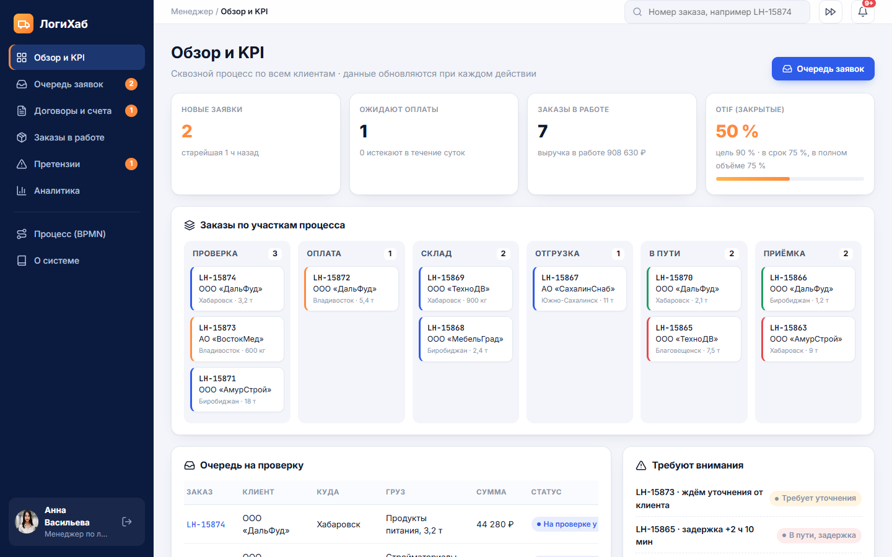

<div align="center">

# 🚚 ЛогиХаб · веб- и мобильное приложение

**Платформа управления логистикой: заявка и расчёт, договор-счёт, оплата, склад, рейс, приёмка, претензии и OTIF – в одном окне**

[](https://github.com/starpxand/logihub-app/actions/workflows/ci.yml)


[](LICENSE)

**[Открыть приложение](https://starpxand.github.io/logihub-app/)** ·
[Скачать APK](https://github.com/starpxand/logihub-app/releases/latest) ·
[Wiki продукта](https://starpxand.github.io/logihub-wiki/) ·
[BPMN-модель](https://starpxand.github.io/logihub-wiki/process/) ·
[Дашборд](https://github.com/starpxand/logihub-dashboard) ·
[Telegram-боты](https://github.com/starpxand/logihub-telegram-bot) ·
[UX/UI-макет](https://github.com/starpxand/logihub-design)



</div>

## О проекте

Приложение – рабочая реализация [UX/UI-макета](https://github.com/starpxand/logihub-design) транспортно-логистической
компании **«ЛогиХаб»** (вариант 15 «Процесс управления логистикой»). Оно продолжает
[Telegram-ботов](https://github.com/starpxand/logihub-telegram-bot) и [дашборд](https://github.com/starpxand/logihub-dashboard):
статусы заказа, допустимые переходы, тарифная модель и расчёт OTIF у всех трёх продуктов общие.

**Цель** – провести каждый заказ через все 26 этапов BPMN-модели в одном интерфейсе для пяти ролей
и видеть KPI процесса (OTIF) сразу после закрытия заказа.

| Роль | Экраны | Этапы BPMN |
|---|---|---|
| Клиент | обзор, новая заявка с расчётом, мои заказы, трекинг на карте, счета и документы, приёмка и претензии | 1–2, 5–6, 8, 20–22 |
| Менеджер | обзор и KPI, очередь заявок с проверкой, договоры и счета, канбан заказов, претензии, аналитика | 3–4, 7, 9, 23–26 |
| Кладовщик | лист комплектации со сверкой сканированием, докомплектование, ТТН и зона отгрузки | 10–13 |
| Диспетчер | карта рейсов, назначение транспорта, отклонения от графика и перепланирование, автопарк | 14, 17–18 |
| Водитель | маршрутный лист на телефоне: начать рейс, геопозиция, задержка, доставка | 15–16, 19 |

## Основные возможности

- **Расчёт стоимости и срока** (этап 6) прямо в форме заявки – по той же тарифной модели, что в боте:
  расстояние × тариф ТС × коэффициент груза + вес + оформление, страхование 0,3 %; тип ТС подбирается по весу и режиму.
- **Все шлюзы процесса**: «Заявка корректна?» с циклом уточнения, «Оплата за 3 дня?» с автоматической отменой,
  «Груз укомплектован?» с докомплектованием, «Есть замечания?» с претензией и решением менеджера.
- **Таймеры**: автоотмена неоплаченного заказа через 3 дня и напоминание за сутки; отклонение от графика
  срабатывает при отставании более 2 часов. Для защиты есть «демо-время» – сдвиг часов приложения вперёд.
- **Документы** для печати и PDF: договор-счёт, лист комплектации, ТТН, маршрутный лист, акт приёмки, претензия.
- **Карта рейсов** сети ЛогиХаб (Комсомольск-на-Амуре → Хабаровск, Биробиджан, Владивосток, Благовещенск,
  Южно-Сахалинск через паром Ванино – Холмск).
- **Аналитика** – интеграция дашборда: OTIF по месяцам против цели 90 %, выручка и прибыль, регионы, затраты,
  OTIF по релизам платформы (5 990 заказов 2024–2026 гг.) и OTIF живых заказов приложения.
- **Уведомления** по ролям, поиск заказа по номеру, ссылки на Telegram-ботов (`/status LH-…`).
- **PWA и Android**: работает офлайн, устанавливается на телефон; APK – нативная обёртка WebView.

## Установка и запуск

Нужен только Python 3 (как веб-сервер для статических файлов) или любой другой HTTP-сервер.

```bash
git clone https://github.com/starpxand/logihub-app.git
cd logihub-app
python -m http.server 8770
# открыть http://127.0.0.1:8770/
```

Пересобрать данные аналитики из выгрузки дашборда (репозиторий `logihub-dashboard` рядом):

```bash
python tools/build_data.py
```

Сквозной тест процесса через интерфейс (Playwright + Chrome):

```bash
pip install playwright && python -m playwright install chromium
python tests/e2e.py                 # при запущенном http.server на порту 8770
```

Сборка Android-приложения (JDK 17+, Android SDK 34): см. [`android/README.md`](android/README.md).

## Как пользоваться

1. Откройте приложение и выберите роль на экране входа (демо-учётные записи, пароль `logihub`).
2. **Клиент** – «Новая заявка»: маршрут, груз, вес; стоимость считается сразу. Отправьте менеджеру.
3. **Менеджер** – «Очередь заявок»: проверьте заявку и нажмите «Заявка корректна» или верните на уточнение.
4. **Клиент** – «Счета и документы»: согласуйте договор-счёт и оплатите (по счёту, картой или СБП – демо).
5. **Кладовщик** – «Задания на сборку»: отсканируйте места; при недовложении – «Докомплектовать», затем ТТН.
6. **Диспетчер** – «Планирование»: постройте маршрут и назначьте машину; в «Отклонениях» – перепланирование.
7. **Водитель** – «Мой рейс»: начните рейс, обновляйте геопозицию, отметьте доставку.
8. **Клиент** – «Приёмка и претензии»: подпишите акт или оформите претензию с фото; **менеджер** решает её.
9. Заказ закрывается, OTIF пересчитывается – смотрите «Обзор и KPI» и «Аналитику».

Карта процесса со всеми 26 этапами – пункт меню «Процесс (BPMN)». Данные демо-режима хранятся в браузере;
сбросить их можно в «Демо-время» → «Сбросить демо-данные».

## Тестирование

Протокол – [`docs/TESTING.md`](docs/TESTING.md): 13 сквозных проверок по всем этапам BPMN (заявка → … → OTIF),
таймер автоотмены и мобильная вёрстка; обнаруженные при разработке проблемы и их решения.
CI ([`ci.yml`](.github/workflows/ci.yml)) запускает тест при каждом push и публикует сайт на GitHub Pages из `main`.

## Структура

```text
logihub-app/
├── index.html, manifest.webmanifest, sw.js   # оболочка PWA и офлайн-кэш
├── css/app.css                               # дизайн-токены макета, адаптив, печать
├── js/
│   ├── store.js      # заказы, статусы и переходы BPMN, таймеры, KPI, демо-данные
│   ├── pricing.js    # тарифная модель (как logihub_bot/pricing.py)
│   ├── actions.js    # действия процесса по ролям
│   ├── map.js, charts.js, ui.js, main.js
│   └── views/        # экраны: login, client, manager, warehouse, dispatcher, driver, analytics, docs, common
├── data/analytics.json                       # сводка выгрузки дашборда (tools/build_data.py)
├── android/                                  # Android-проект (WebView) для сборки APK
├── tests/e2e.py                              # сквозной тест через интерфейс
└── docs/                                     # протокол тестирования, скриншоты
```

## Ветки

| Ветка | Назначение |
|---|---|
| `main` | стабильная версия, публикуется на GitHub Pages, релизы APK |
| `development` | интеграция готовых функций |
| `feature/web-app` | экраны и логика процесса веб-приложения |
| `feature/android-apk` | Android-обёртка и сборка APK |

## Автор и ссылки

**Попов А.С.**, группа 5ИТб-2, ФГБОУ ВО «КнАГУ» · GitHub [@starpxand](https://github.com/starpxand)

Проект по дисциплине «Современные программные средства», 2026:
[wiki](https://starpxand.github.io/logihub-wiki/) · [дашборд](https://github.com/starpxand/logihub-dashboard) ·
[Telegram-боты](https://github.com/starpxand/logihub-telegram-bot) · [макет](https://github.com/starpxand/logihub-design) ·
клиентский бот [@logihub_logistics_bot](https://t.me/logihub_logistics_bot), бот сотрудников [@logihub_manager_bot](https://t.me/logihub_manager_bot).

Лицензия – [MIT](LICENSE).
